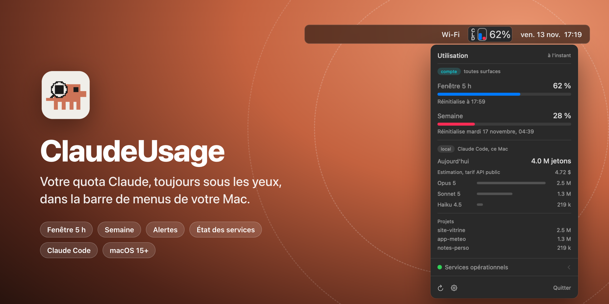
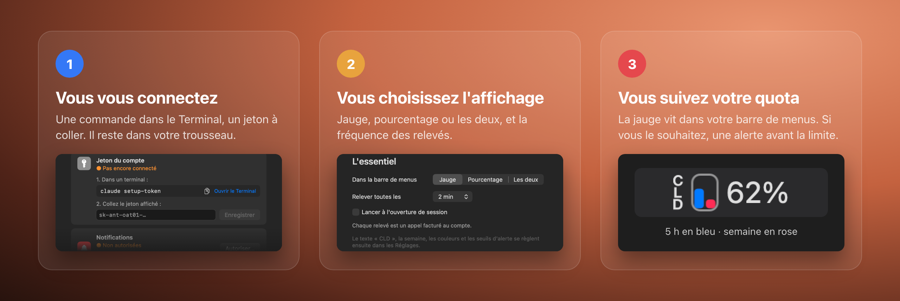
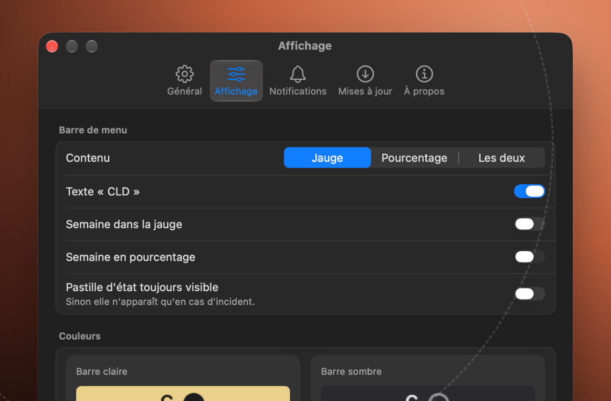
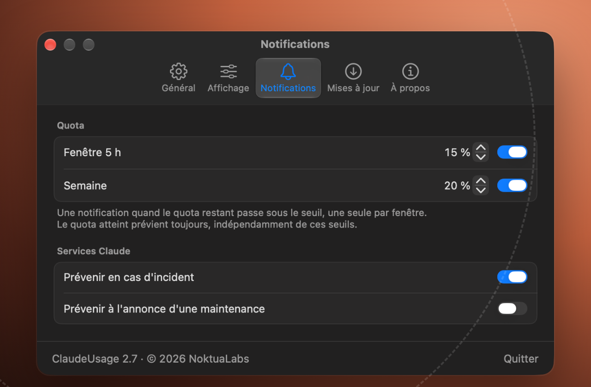
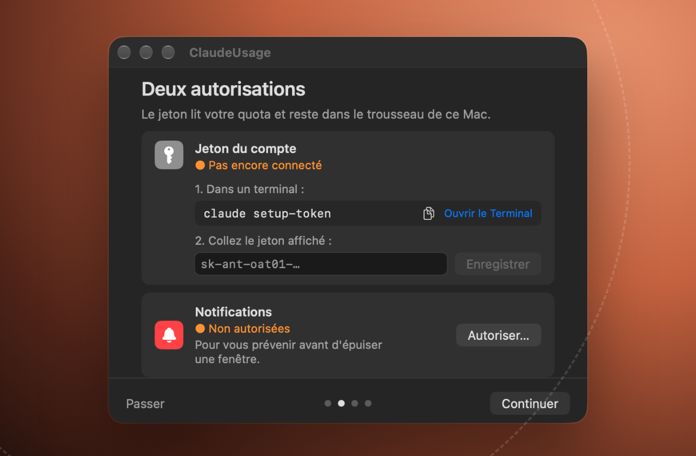
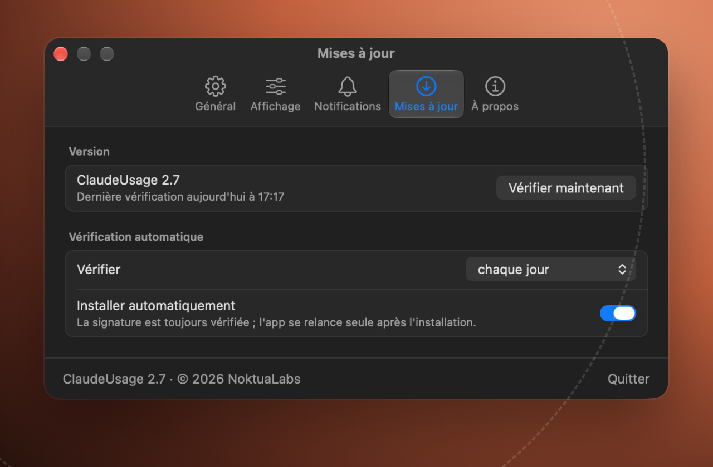

  <a href="https://github.com/NoktuaLabs/ClaudeUsage-releases/releases/latest"><b>⬇&nbsp;&nbsp;Télécharger ClaudeUsage pour macOS</b></a> 
  macOS 15 ou plus récent · Mac à puce Apple · abonnement Claude

Ce dépôt contient les **versions publiées** de ClaudeUsage. Les sources ne sont pas publiques.

ClaudeUsage est une app indépendante, non affiliée à Anthropic.

## Comment ça marche

ClaudeUsage relève votre quota auprès d'Anthropic à l'intervalle de votre choix et l'affiche en permanence dans la barre de menus. Un clic sur la jauge ouvre le détail : les deux fenêtres, l'heure de leur remise à zéro, l'état des services Claude et votre consommation Claude Code sur ce Mac.

## Ce qu'elle sait faire

<table>
<tr>
<td width="50%"> <b>À votre façon dans la barre</b> Jauge, pourcentage ou les deux, avec ou sans la semaine. Deux jeux de couleurs, un pour la barre claire, un pour la barre sombre.</td>
<td width="50%"> <b>Prévenu à temps</b> Une alerte avant d'épuiser une fenêtre, au seuil que vous choisissez. Une autre en cas d'incident ou de maintenance annoncée sur les services Claude.</td>
</tr>
<tr>
<td width="50%"> <b>Votre jeton reste chez vous</b> Vous le créez vous-même avec Claude Code. Il est rangé dans le trousseau de ce Mac et ne sert qu'à interroger l'API d'Anthropic.</td>
<td width="50%"> <b>Des mises à jour contrôlées</b> L'app vous propose chaque nouvelle version avec sa note, et vérifie sa signature avant de l'installer.</td>
</tr>
</table>

Et aussi : la consommation locale de **Claude Code**, par modèle et par projet, lue sur votre Mac, et un thème clair, sombre ou celui du système.

## Installer

1. Téléchargez `ClaudeUsage-<version>.dmg` depuis la [dernière version](https://github.com/NoktuaLabs/ClaudeUsage-releases/releases/latest).
2. Ouvrez-le et glissez **ClaudeUsage** dans le dossier **Applications**.
3. Au premier lancement, macOS refuse d'ouvrir l'app : allez dans **Réglages Système → Confidentialité et sécurité**, puis cliquez sur **Ouvrir quand même**.
4. L'assistant de démarrage vous guide : la connexion de votre compte, les notifications, et deux réglages.

Il vous faut un **abonnement Claude** et **Claude Code** installé sur ce Mac : le jeton de connexion se crée avec `claude setup-token`, qui exige un abonnement.

## Questions fréquentes

<b>Où est mon jeton, et qui le voit ?</b>

 

Vous créez le jeton vous-même, dans le Terminal, avec la commande `claude setup-token`, puis vous le collez dans l'app. ClaudeUsage le range dans le **trousseau de ce Mac**, dans un élément qui lui est propre, lisible seulement quand votre session est déverrouillée et jamais synchronisé vers un autre appareil. Il ne lit pas les identifiants de Claude Code.

Le jeton ne part que vers l'API d'Anthropic, pour lire votre quota. Il est valable un an ; s'il est révoqué ou expiré, l'app vous le dit et vous redonne la marche à suivre.

<b>Quelles données quittent mon Mac ?</b>

 

L'app contacte trois adresses, et seulement elles :

- **l'API d'Anthropic**, avec votre jeton, pour relever votre quota ;
- **status.claude.com**, la page publique d'état des services Claude ;
- **GitHub**, ce dépôt, pour savoir s'il existe une nouvelle version.

Votre consommation Claude Code est calculée à partir des journaux que Claude Code écrit sur votre Mac. Elle n'est envoyée nulle part. Pas de compte NoktuaLabs, pas de statistiques d'usage.

<b>Le relevé consomme-t-il mon quota ?</b>

 

Un tout petit peu. Anthropic ne donne le quota qu'en réponse à une vraie requête : chaque relevé envoie donc la plus petite demande possible au modèle le plus léger, avec une réponse limitée à un seul jeton. C'est pour cela que l'intervalle se règle, de 90 secondes à 15 minutes ; il est de 2 minutes par défaut.

<b>Que montre la partie Claude Code ?</b>

 

Ce que Claude Code a consommé sur ce Mac : aujourd'hui, par modèle et par projet. Le montant affiché est une **estimation au tarif public de l'API**, un simple repère : un abonnement Claude n'est pas facturé au jeton. Cette partie ne concerne que ce Mac ; la jauge, elle, compte tout votre compte.

<b>Pourquoi macOS refuse-t-il d'ouvrir l'app ?</b>

 

ClaudeUsage n'est pas distribuée par l'App Store et n'est pas notarisée par Apple. Au premier lancement, macOS la bloque par précaution. Pour l'autoriser une fois pour toutes :

1. Essayez d'ouvrir ClaudeUsage, puis fermez le message d'avertissement.
2. Ouvrez **Réglages Système → Confidentialité et sécurité**.
3. En bas, à côté de la mention de ClaudeUsage, cliquez sur **Ouvrir quand même**, puis confirmez.

Vous n'aurez plus à le refaire.

<b>Comment se font les mises à jour ?</b>

 

Chaque version est publiée ici, avec sa note de version. L'app vérifie d'elle-même s'il en existe une plus récente — chaque jour par défaut — et vous la propose. Vous pouvez l'installer, la remettre à plus tard ou l'ignorer.

Avant de remplacer quoi que ce soit, elle vérifie que la nouvelle version est **signée par le même certificat** qu'elle et qu'elle porte bien le numéro annoncé. Sinon, elle refuse et vous dit pourquoi. Si vous préférez ne plus vous en occuper, cochez **Installer automatiquement** dans les Réglages : les mêmes contrôles s'appliquent, puis l'app se relance seule.

<b>macOS me demande mon mot de passe pour le trousseau. C'est normal ?</b>

 

Cela peut arriver après une mise à jour : macOS veut confirmer que la nouvelle version a le droit de lire le jeton rangé par l'ancienne. ClaudeUsage vous prévient avant avec un écran qui l'explique. Répondez **Toujours autoriser**, sinon la demande reviendra à chaque relevé.

 

<b>NoktuaLabs</b>

